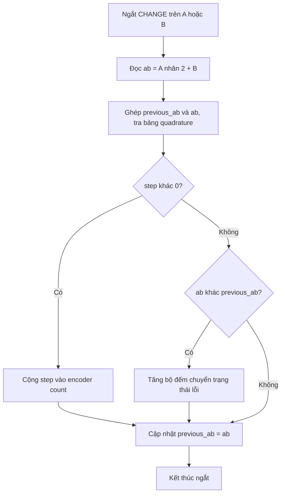
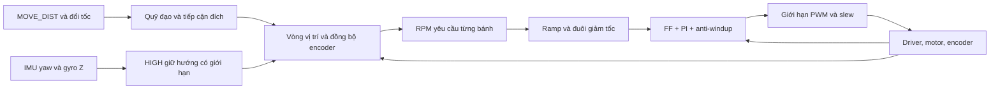

# Hướng dẫn điều khiển và tính toán — C8 + A1

Bảng thông số ở [README](README.md); snapshot máy đọc ở [accepted_a1.json](config/accepted_a1.json). Công thức dưới đây giải thích các khâu chính; điều kiện nhánh/giới hạn chi tiết nằm trong mã nguồn.

## 1. Phần cứng

| Tín hiệu | M1 trái | M2 phải |
|---|---|---|
| Encoder A / B | GPIO34 / GPIO35 | GPIO36 / GPIO39 |
| Hai đầu PWM driver | GPIO18 / GPIO19 | GPIO25 / GPIO26 |
| Driver SD | GPIO23 | GPIO27 |
| Dấu motor / encoder khi tiến | −1 / −1 | +1 / +1 |

IMU SDA21/SCL22, I²C100 kHz; trục X hướng trước, Z hướng lên theo cấu hình lắp hiện tại. GPIO34–39 là input, không có pull-up nội. Tín hiệu encoder phải phù hợp mức logic ESP32, không đưa5 V trực tiếp vào GPIO.

PWM20 kHz,10 bit. Trần470 tương ứng45.94% duty trên thang1023; duty không cho biết trực tiếp mô-men/dòng điện/công suất cơ.

## 2. Ngắt encoder A/B

Cả A và B gắn ngắt `CHANGE`. ISR đọc hai bit, ghép trạng thái cũ/mới thành chỉ số0–15 tra bảng quadrature. Chuyển hợp lệ cộng/trừ1 count; nhảy hai bit được ghi vào bộ đếm chuyển trạng thái bất hợp lệ. ISR không tính PI hoặc gửi serial.



998.4 là count/vòng bánh theo cấu hình giải mã và truyền động hiện tại, không nhân thêm4. Với D=0.1 m:

\[
s=\frac{n}{998.4}\pi D,\qquad v=\frac{RPM}{60}\pi D.
\]

100 count≈31.47 mm;0.3 m/s≈57.30 RPM;0.6 m/s≈114.59 RPM. Trượt lốp, biến dạng bánh và dây đai có thể làm đường thực khác encoder.

RPM dùng cửa sổ khoảng100 ms rồi lọc `rpm = 0.6 * raw + 0.4 * previous`. Loop20 ms không đồng nghĩa mỗi tick có phép đo vận tốc độc lập hoàn toàn mới. Cửa sổ giảm nhiễu lượng tử nhưng tạo trễ phản hồi.

## 3. Động học vi sai

v dương khi tiến, omega dương quay trái; B=0.4 m:

\[
v=\frac{v_R+v_L}{2},\quad \omega=\frac{v_R-v_L}{B},\qquad
v_L=v-\frac{B\omega}{2},\quad v_R=v+\frac{B\omega}{2}.
\]

\[
\dot x=v\cos\theta,\quad\dot y=v\sin\theta,\quad\dot\theta=\omega.
\]

Quay tại chỗ: hai bánh ngược chiều, độ dài đường lý tưởng mỗi bánh `B*abs(theta)/2`.180° tương ứng0.6283 m/bánh;360° tương ứng1.2566 m/bánh. Lốp cọ sàn làm góc thân khác góc encoder nên cần phản hồi IMU khi quay.

Ví dụ v=0.4 m/s, omega=+0.1 rad/s: vL=0.38, vR=0.42 m/s. Đây là quan hệ giải thích bù hướng; firmware chưa xuất lệnh nhận `(v, omega)` tổng quát.

## 4. Chuỗi điều khiển



Vòng ngoài giao RPM; PI thực hiện RPM bằng PWM. Tăng Kp không khắc phục yêu cầu vượt trần. Đúng quãng đường không tự chứng minh bám tốc tức thời tốt; encoder hai bánh bằng nhau không tự chứng minh thân xe thẳng trên sàn.

Telemetry `base`: RPM trước tạo dạng; `sp`: RPM sau tạo dạng; `rpm`: RPM đo. KPI bám RPM so `rpm` với `sp` cùng bánh/cùng thời điểm trong cửa sổ phù hợp, không so với tốc độ hành trình trong pha tăng/giảm tốc.

## 5. PI, FF và anti-windup

Mỗi motor, sau quy đổi theo chiều lệnh:

\[
e_k=sp_k-rpm_k,\quad P_k=K_p e_k,
\]

\[
I_k=I_{k-1}+[K_i e_k+K_{aw}(u_{k-1}-u^*_{k-1})]\Delta t,
\]

\[
FF_k=\operatorname{clamp}(a\,sp_k+b,0,u_{max}),\quad u^*_k=FF_k+P_k+I_k.
\]

Sau đó giới hạn biên độ và bước PWM. `u*` là tổng trước giới hạn; `u` đã áp dụng. Kaw dùng sai biệt **chu kỳ trước** để I không tăng quá mức khi đầu ra bị hạn chế. Mã còn chặn I trong−0.5 đến1.5 lần trần PWM và reset theo điều kiện dừng/zero-SP.

Ví dụ LOW M1: sp50, đo48 RPM, I trước4 PWM, u trước200, u* trước210, dt0.02 s:

- P=3.24×2=6.48 PWM; FF=3.13×50+45.9=202.4 PWM.
- deltaI=(1.2×2+0.5×(200−210))×0.02=−0.052 PWM.
- I mới3.948; u*=212.828 PWM. Bước12.828 nhỏ hơn slew27 nên khâu slew không hạn chế ở ví dụ này, trước lượng tử hóa phần cứng.

| Thành phần | Vai trò | Giới hạn |
|---|---|---|
| P | Sửa sai số hiện tại | Kp lớn tăng ảnh hưởng nhiễu/trễ |
| I | Bù sai số kéo dài | Quá mạnh dễ dư lực khi giảm tốc |
| FF | Ước lượng PWM từ RPM | Sai khi tải/điện áp/ma sát đổi |
| Kaw | Kéo I theo đầu ra thực | Không tạo thêm mô-men khi chạm trần |
| Slew | Hạn chế bước PWM | Quá thấp làm đầu ra không theo kịp SP |

Vòng tốc độ là **PI**, không có D tốc độ. HIGH dùng PD hướng riêng; không vì thế mà gọi vòng tốc độ là PID. Thêm D vào RPM đo theo cửa sổ có thể tăng nhiễu, phải có thực nghiệm chứng minh trước khi áp dụng.

Ramp320 RPM/s cho phép tăng SP khoảng6.4 RPM/20 ms. Jerk1500 RPM/s² định hình đuôi giảm từ SP dương xuống SP dương thấp hơn, không phải giới hạn jerk đầy đủ mọi pha. Về đúng0 dùng nhánh ramp riêng của C8.

## 6. Bank và IMU

Có bốn bộ: LOW M1/M2 và HIGH M1/M2. Với độ lớn tốc độ **yêu cầu** v, trọng số HIGH:

\[
\alpha=0\ (v\le.3),\quad\alpha=1\ (v\ge.4),\quad
\alpha=x^2(3-2x),\ x=(v-.3)/.1\ \text{ở giữa}.
\]

0.35 m/s cho trọng số đích0.5. Nội suy Kp/Ki/Kaw/slope/offset; ramp/jerk hai bank phải bằng nhau. Bắt đầu lượt chọn trọng số theo lệnh; khi đổi tốc, trọng số thay đổi có giới hạn150 ms từ0 đến1. I được bù lại theo thay đổi P/FF để giảm bước nhảy PWM, vẫn có clamp.

HIGH xét tốc độ lệnh, không đợi RPM thực vượt0.3 m/s. Lượt đặt0.5 có thể dùng HIGH từ pha tăng tốc; pha cuối có điều kiện giữ/giảm trọng số riêng, không chuyển cứng theo tốc độ thực.

Giữ hướng HIGH:

\[
\omega_{raw}=k_{yaw}\,wrap(\psi_{ref}-\psi)-k_{rate}\,g_z.
\]

Wrap về[−pi,pi]; giới hạn slew0.75 rad/s², biên độ0.15 rad/s rồi nhân trọng số HIGH. Tạo chênh vận tốc bánh theo B, kết hợp đồng bộ encoder/dự trữ RPM. a_max0.5 m/s² giới hạn tăng tốc HIGH. Riêng tăng từ0 lên0.6 với0.5 m/s² cần tối thiểu0.36 m trong mô hình lý tưởng, chưa gồm dừng/bù/chốt đích.

IMU không reset yaw mỗi lượt; controller chụp hướng tham chiếu. Mẫu stale/invalid hoặc đổi calibration epoch không được dùng tiếp như dữ liệu mới. LOW đi thẳng≤0.3 không thêm vòng giữ hướng IMU.

TURN_TIME dùng góc tích lũy để phân biệt360° với0°. C8 có một đợt xung cuối khi đã dừng và còn thiếu>0.35° đến≤2°, trong deadline gốc: yêu cầu40–140 ms, PWM≤120, vận tốc bánh yêu cầu≤0.03 m/s, dung sai tick≤40 ms. Không tự quay ngược sửa quá góc. Đây là giới hạn logic, không cam kết góc thực luôn đạt một dung sai cụ thể.

IMU WHO_AM_I hỗ trợ0x68/0x70: gyro±500°/s, accel±4g, DLPF gyro42 Hz/accel44 Hz, task100 Hz. Bộ quan sát bù bias/ước lượng quaternion; accelerometer hỗ trợ roll/pitch. Không có từ kế hay tham chiếu yaw tuyệt đối nên yaw vẫn có thể trôi. Hiệu chỉnh lúc đứng yên, sau warm-up.

## 7. Giao thức serial

ASCII230400 baud, một lệnh mỗi dòng kết thúc `\n`: `request_id VERB arguments...`. ACK JSON có `type`, `request`, `boot`, `ok`, `command`. ACK thành công không chứng minh hoàn tất lượt. `request_id` ghép phản hồi; `run_id` là danh tính lượt, uint32 khác0.

| Cú pháp sau request_id | Ý nghĩa |
|---|---|
| `STATUS` | Trạng thái hiện tại |
| `CONFIG_GET`, `GS_GET`, `HIGH_CTRL_GET`, `TURN_CTRL_GET` | Đọc cấu hình |
| `HEARTBEAT` | Gia hạn giám sát host |
| `IMU_CALIBRATE` | Hiệu chỉnh lúc IDLE/đứng yên |
| `MOVE_DIST distance_m cruise_mps timeout_s run_id` | Đường dương tiến/âm lùi; cruise dương |
| `SPEED_UPDATE cruise_mps run_id sequence` | Đổi tốc cùng lượt; sequence bắt đầu1, tăng đúng1 |
| `TURN_TIME angle_rad duration_s run_id` | Dương trái/âm phải; góc5°–360° |
| `SOFT_STOP`, `STOP`, `CLEAR` | Dừng mềm, ngắt đầu ra, xóa lỗi đủ điều kiện |
| `CONFIG max_rpm max_pwm slew sync_kp trim divergence_m` | Đặt giới hạn lúc đủ điều kiện |
| `TUNE motor Kp Ki Kaw slope offset ramp jerk` | LOW motor1/2, lúc IDLE |
| `GS_TUNE motor Kp Ki Kaw slope offset ramp jerk` | Stage HIGH motor1/2 lúc đứng yên |
| `GS_ENABLE enable transition_ms` | Commit hai HIGH đã stage, hoặc disable scheduling;100–500 ms |
| `HIGH_CTRL_SET 2 a_max k_yaw k_rate max_omega slew_omega` | Chỉ mode2; hệ số còn chỉnh được lúc dừng |
| `TURN_CTRL_SET 1` | Chỉ bật, cần IMU khỏe |

Ví dụ **cú pháp**, không phải script tự chạy/nguồn heartbeat:

```text
1 STATUS
2 CONFIG_GET
3 GS_GET
4 HIGH_CTRL_GET
5 TURN_CTRL_GET
6 IMU_CALIBRATE
7 HEARTBEAT
8 MOVE_DIST -1.2 0.3 20 1001
9 SPEED_UPDATE 0.4 1001 1
10 STOP
```

Đổi tốc có thể bị từ chối khi đã vào pha cuối, sai run/sequence, hết thời gian, thiếu đường, mất heartbeat/IMU hoặc vượt giới hạn. Không reset đích/chiều/deadline. Quay phải180°: `TURN_TIME -3.14159265 7 1002`, sau khi lượt trước dừng và đủ điều kiện. Không gửi hàng loạt mà bỏ kiểm tra trạng thái.

CONFIG/TUNE vô hiệu hóa scheduling để tránh phối hợp bank dở dang. Sau chỉnh, stage đủ hai HIGH rồi `GS_ENABLE 1 150`, đọc GET xác nhận. Runtime có thể disable scheduling để bảo trì; chính sách HIGH vẫn chỉ mode2. Reset nạp lại A1/scheduling mặc định. Không còn parser cho MOVE/MOVE_TIME/SPEED/TURN hay mode0/1/tắt turn feedback.

## 8. Dừng, KPI và ROS2

Watchdog480 ms; timing fault khi loop>40 ms; stall từng motor800 ms; mất xung cả hai300 ms theo điều kiện core. Divergence40 mm là bảo vệ, không phải độ chính xác mục tiêu. Đứng yên xét RPM<1.5 và quiet≥200 ms, không chỉ PWM0. STOP/fault disable driver có thể để xe trôi.

RMSE ghi rõ đơn vị/cửa sổ. Lượt ngắn thiếu đoạn ổn định phải ghi thiếu dữ liệu; không tự coi là đạt hoặc lỗi controller. Đo quãng đường/yaw bằng encoder/IMU phải phân biệt với phép đo độc lập trên sàn.

Pi5 cần bridge sở hữu serial, quản lý heartbeat/ACK/boot/run ID/timeout/STOP/timestamps. Hiện chưa có twist liên tục đầy đủ cho Nav2; không thể đổi tên SPEED_UPDATE thành cmd_vel rồi coi đã tích hợp xong.

EKF ROS2 ước lượng pose từ encoder/IMU, còn vòng IMU ESP32 điều khiển bánh, nên có thể cùng tồn tại. Cần thống nhất frame, dấu yaw, rad/s, timestamp, covariance và reset epoch. Odometry encoder thô phải giữ độc lập, không trộn IMU vào odom rồi coi cả hai là phép đo độc lập. Khi ROS2 yêu cầu quay, vòng giữ hướng phải theo ý định lệnh, không chống lại omega; giao diện twist đó chưa triển khai trong gói này.
