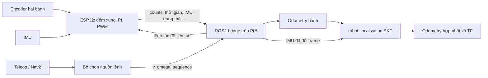

# Lộ trình Raspberry Pi 5 / ROS2

Tài liệu mô tả các phần cần bổ sung, không phải chức năng ROS2 đã có trong R4.

## 1. Điểm xuất phát

| Hạng mục | Hiện tại | Bước tiếp theo |
|---|---|---|
| Encoder có dấu, RPM, PI/FF, PWM | Có trên ESP32 | Giữ vòng điều khiển tại ESP32 |
| Quãng đường từng bánh theo lượt | Có | Gửi counts cộng dồn theo boot, không reset theo lượt |
| IMU, HIGH giữ hướng, quay bù IMU | Có | Chuẩn hóa frame/thời gian cho Pi |
| Odometry liên tục `(x,y,phi)` | Chưa có | Tính trên Pi từ chênh counts |
| ROS2 bridge, `/cmd_vel`, EKF | Chưa có | Triển khai theo giai đoạn |
| SLAM, định vị bản đồ, Nav2 | Chưa có trong gói | Làm sau bridge/odometry |

Đi/về gần home không chứng minh đã có odometry hoặc định vị bản đồ. Encoder đo quay bánh; trượt vẫn tạo sai số vị trí thực.

## 2. Phân công ESP32 và Pi 5



Vòng motor 50 Hz tiếp tục chạy tại ESP32, độc lập với ROS2, mạng, log và RViz. Pi xử lý động học, odometry, EKF và điều hướng. Giữ C8+A1 làm baseline so hồi quy; thêm giao thức trên nhánh riêng.

## 3. Giai đoạn A — dữ liệu có thời gian

### Dữ liệu tối thiểu ESP32 gửi

| Trường dự kiến | Quy ước |
|---|---|
| `protocol_version`, `boot_id`, `seq` | Phát hiện phiên bản, reboot, mất/đảo gói |
| `sample_time_us` hoặc thời gian MCU tương đương | Thời điểm lấy mẫu, không phải gửi xong |
| `counts[2]` | Số xung int64 cộng dồn, có dấu, cùng snapshot |
| `rpm[2]` | Chẩn đoán, không thay counts làm nguồn quãng đường chính |
| `gyro[3]`, `accel[3]`, tùy chọn quaternion | rad/s, m/s², frame xác định |
| `imu_sample_time`, `imu_valid`, `calibration_epoch` | Không coi IMU cũ là đồng thời với encoder |
| State, fault, nguồn điều khiển | Phân biệt IDLE, manual, ROS, setpoint |
| Điện áp và phần trăm pin | Không giả lập dòng hoặc trạng thái sạc |

Counts không reset mỗi MOVE_DIST/đổi mode; mốc `origin` dùng cho hành trình C8 vẫn riêng. Pi lấy delta giữa hai snapshot hợp lệ. Mất một gói có thể bù chuyển động tổng bằng counts ở gói sau, nhưng mất dài vẫn giảm độ chính xác quỹ đạo/phân giải thời gian.

Reboot: dựa boot ID để đặt lại mốc counts/thời gian, không tích phân cú nhảy qua lần reboot. Quy định rõ giữ/reset odom và báo gián đoạn. Xử lý rollover nếu timestamp 32 bit; ánh xạ thời gian đơn điệu MCU sang thời gian ROS, không dùng thẳng `millis()` làm ROS epoch. Từ chối gói lùi thời gian, trùng sequence hoặc sai độ dài/CRC.

### Chọn truyền thông

Ưu tiên UART 3,3 V có GND chung hoặc USB-serial ổn định giữa Pi và ESP32. UART đấu chéo TX/RX trên chân còn trống; không đưa 5 V vào GPIO. Điện thoại vẫn dùng Wi-Fi nhưng phải có bộ chọn quyền điều khiển chung.

R4 Wi-Fi hiện cho serial đọc trạng thái và STOP, không nhận chạy qua serial. Cần transport/authority mới cho ROS2; không gửi lệnh chạy vào R4 rồi mặc định được chấp nhận. HTTP `/api/state` cũng chưa cung cấp đủ counts cho bridge.

Bridge serial thông thường dễ giữ nguyên vòng motor và debug. Micro-ROS là phương án khác nhưng thêm agent, phụ thuộc build và quản lý kết nối. Nếu chọn Wi-Fi, đo latency, jitter, mất mạng và tương tác dashboard trước khi quyết định.

Đề xuất encoder 50 Hz, IMU theo mẫu 100 Hz hoặc tốc độ gửi phù hợp băng thông. Serial 230400 baud 8N1 có trần khoảng 23 kB/s; không gửi toàn bộ STATUS JSON hiện tại ở 50 Hz. Chọn frame gọn có phiên bản/độ dài/sequence/CRC, đo kích thước thực và để dư băng thông ACK/STOP. Không thay chu kỳ PI/watchdog để giải quyết nghẽn truyền.

## 4. Giai đoạn B — odometry bánh trên Pi

Chênh số xung đã chuẩn hóa chiều tiến của từng bánh:

```text
delta_s_L = delta_N_L * pi * D_L / CPR
delta_s_R = delta_N_R * pi * D_R / CPR
delta_s   = (delta_s_R + delta_s_L) / 2
delta_phi = (delta_s_R - delta_s_L) / b
```

Hình học khởi đầu: `D_L = D_R = 0.100 m`, `b = 0.400 m`, `CPR = 998.4 count/vòng bánh` theo bộ giải mã hiện tại. Không nhân thêm 4 khi CPR đã chứa hệ số giải mã. Counts trong core đã áp dụng dấu encoder; bridge không nhân dấu lần nữa.

REP-103: x tiến, y trái, z lên; yaw dương ngược chiều kim đồng hồ nhìn từ trên. Đối chiếu bánh trái/phải và phép đổi frame IMU bằng thử vật lý. Core có `D2_YAW_SIGN = -1` theo đối chiếu trên xe; giữ baseline, không chép máy móc dấu đó vào ROS hoặc tự đảo dây/dấu để khớp công thức lý tưởng.

Tích phân cung tròn mỗi bước, `sinc(a) = sin(a)/a`, `sinc(0) = 1`:

```text
x_next   = x + delta_s * sinc(delta_phi/2) * cos(phi + delta_phi/2)
y_next   = y + delta_s * sinc(delta_phi/2) * sin(phi + delta_phi/2)
phi_next = phi + delta_phi
v        = delta_s / delta_t
omega    = delta_phi / delta_t
```

Giữ góc liên tục nội bộ để không mất lượt qua ±pi; đổi sang quaternion khi xuất ROS. Dùng thời gian mẫu encoder cho delta_t, từ chối delta_t không dương hoặc khoảng mất mẫu quá lớn theo chính sách đã kiểm thử.

Node xuất `nav_msgs/Odometry` trên topic đề xuất `/wheel/odometry`, `frame_id=odom`, `child_frame_id=base_link`. Covariance dựa phép đo và trượt, không điền toàn 0. RPM đã lọc phục vụ chẩn đoán; counts là nguồn chính tích phân quãng đường.

## 5. Giai đoạn C — lệnh vận tốc và quyền điều khiển

Thêm đường lệnh liên tục `(v, omega)` cho teleop/Nav2; không biến `/cmd_vel` thành nhiều MOVE_DIST ngắn. Chốt kiểu message (`Twist`/`TwistStamped`) theo phiên bản ROS2 và thời hạn lệnh.

```text
v_L = v - b * omega / 2
v_R = v + b * omega / 2
RPM_i = v_i * 60 / (pi * D_i)
```

Giới hạn tốc độ bánh và gia tốc; khi chạm trần có thể giảm chung hai lệnh để giữ độ cong. Vận tốc thân 0,6 m/s không bảo đảm còn biên rẽ khi hai bánh đã chạm trần. Giữ giới hạn PWM, slew, đảo chiều và watchdog ESP32.

Một bộ chọn nguồn chung cho remote, hành trình và ROS; STOP ưu tiên. Chuyển nguồn không phát lại lệnh. Pi chết/mất dây/lệnh quá hạn phải khiến ESP32 ngắt đầu ra. Bridge và ESP32 cùng kiểm tra tuổi lệnh; kết nối phục hồi không tự chạy tiếp.

Không để giữ hướng HIGH hoặc đồng bộ vị trí bánh chống lại góc quay ROS yêu cầu. Giữ C8 cho hành trình độc lập; mode `cmd_vel` cần chính sách riêng đã kiểm thử đi thẳng, đi cung và quay. Không mặc định remote hiện tại là bộ chấp hành ROS hoàn chỉnh. Kiểm thử rồi mới quyết định gain scheduling/bù IMU cho mode ROS.

## 6. Giai đoạn D — IMU và EKF

Đổi IMU về frame robot bằng extrinsic đúng; kiểm tra trục, đơn vị và chiều quay. Topic đề xuất `/imu/data` dùng `sensor_msgs/Imu`, timestamp mẫu, covariance phù hợp. Calibration epoch đổi không được biến thành chuyển động quay thật.

IMU 6 trục không cho yaw tuyệt đối: tích phân gyro vẫn trôi. EKF không biến nó thành la bàn tuyệt đối. Đánh giá bias/nhiễu từ dữ liệu thật, không đặt covariance tùy ý nhỏ để làm đồ thị đẹp.

`robot_localization`: bắt đầu `two_d_mode=true`, `world_frame=odom`. Chọn thông tin phù hợp:

- Odometry bánh: vận tốc tiến và thông tin quay theo cấu hình.
- Gyro: yaw rate sau đổi frame/hiệu chỉnh bias.
- Ràng buộc vận tốc ngang 0 chỉ có covariance phản ánh giả thiết không trượt ngang.
- Pose và twist từ cùng counts không phải hai phép đo độc lập tuyệt đối. Yaw tích phân IMU và chính gyro của nó cũng có tương quan; tránh tính hai lần thông tin.

EKF xuất `/odometry/filtered`, là nguồn duy nhất phát TF động `odom -> base_link`; node odometry bánh không phát trùng. `robot_state_publisher`/static TF quản lý `base_link -> imu_link`, `base_link -> laser` theo URDF/vị trí đo thật.

Khi có SLAM/AMCL, thành phần định vị phát `map -> odom`. EKF cục bộ không thay định vị trên bản đồ. Làm wheel+IMU trước, LiDAR/SLAM/Nav2 sau.

## 7. Pin và diagnostics

Ánh xạ sang `sensor_msgs/BatteryState`: `percentage` ở thang 0–1, dữ liệu chưa biết dùng unknown/NaN theo trường. Chưa có đo dòng/tín hiệu sạc thì không tự công bố đang sạc, dòng, Ah còn lại hoặc thời gian sử dụng.

Diagnostics gồm tuổi mẫu, mất gói, boot ID, lỗi motor, nguồn điều khiển. Ghi rosbag trên Pi ngoài vòng thời gian thực ESP32. Cảm biến dòng, phát hiện jack sạc và bảng xả thực nghiệm là bổ sung riêng, không cần đổi gain motor.

## 8. Thứ tự và kiểm tra

| Bước | Đầu ra | Kiểm tra |
|---|---|---|
| A | Counts + thời gian + IMU qua bridge | Đối chiếu counts, mất gói/reboot/rollover; thử vật lý có cho phép |
| B | Odometry bánh, RViz | Tiến/lùi/quay, so quãng đường/góc với phép đo ngoài |
| C | Vận tốc liên tục, chọn nguồn | Đi cung, đổi tốc/đảo chiều, remote/ROS, mất Pi/mạng, không chạy lại lệnh |
| D | EKF và TF duy nhất | Rosbag replay, đứng yên/thẳng/quay ±90/180/360°, đo trôi/covariance |
| E | Định vị/điều hướng | URDF + LiDAR, SLAM/AMCL, Nav2 với giới hạn đã đo |

Giữ hồi quy hai chiều/toàn dải 0,1–0,6 m/s. Đoạn ngắn không đủ đánh giá tốc độ cực đại; dùng đường dài phù hợp và dự phòng dừng. Đo riêng điểm cuối, lệch ngang, góc cuối, bám RPM và thời gian dừng; gần home không chứng minh toàn quỹ đạo chính xác.

Mỗi bước dùng nhánh riêng, lưu baseline R4/C8+A1 và log so sánh. Chốt tiêu chí trước thử, không đổi ngưỡng để biến lượt chưa đạt thành đạt. Chuyển bước theo bằng chứng tương ứng. Không cần viết lại bộ PI đã ổn định để bắt đầu ROS2.
